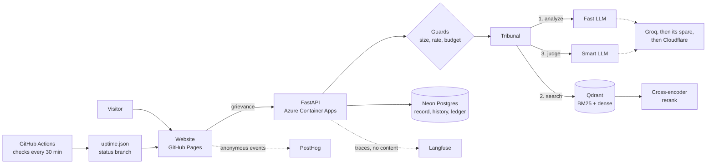

# ⚖️ Tribunal of Ages

**Bring your pettiest grievance before 4,000 years of law.** A production RAG system that judges
modern complaints by real ancient law codes, myths and stories, and quotes the law it used,
word for word.

[](https://github.com/YOUR-GITHUB-USER/tribunal-of-ages/actions/workflows/ci.yml)
[](https://YOUR-GITHUB-USER.github.io/tribunal-of-ages/#system)
[](https://YOUR-GITHUB-USER.github.io/tribunal-of-ages/#system)
[](pyproject.toml)
[](LICENSE)

**[Try it live](https://YOUR-GITHUB-USER.github.io/tribunal-of-ages/)** ·
[System page](https://YOUR-GITHUB-USER.github.io/tribunal-of-ages/#system) ·
[API docs](https://YOUR-API-ADDRESS/docs) ·
[Architecture](#architecture) · [Evaluation](#evaluation)

<!-- Add screenshots to docs/images, then uncomment:


-->

## What it does

- **Judges by real law.** Every verdict cites one law from a curated library of real codes
  (Hammurabi, the Salic Law), myths and public-domain stories, and shows its text word for
  word. The model names laws only by ID, so it can't misquote one.
- **Scales the sentence to your outrage.** An Outrage Dial, from Miffed to Blood Feud, steers
  it toward laws whose penalties match.
- **Holds off-topic requests in contempt.** Ask it for a Flutter app and it charges you with
  contempt of court under a law about wasting a court's time, and writes no code.
- **Publishes a public record, and keeps names private.** Verdicts go public after a consent
  checkbox. Names and photos for the shareable decree image never leave the browser.
- **Shows its own vital signs.** A System page with cases judged, today's capacity, tokens,
  the AI providers' status, and a 90-day uptime history.

## Architecture



| Part | Runs on | Cost |
|---|---|---|
| Website | Plain HTML, CSS and JavaScript on GitHub Pages, two skins, no framework | Free |
| API | FastAPI and Pydantic, Python 3.13, Docker on Azure Container Apps, scaled to zero | Free grant, then student credit |
| Language models | Groq (gpt-oss-20b and 120b), falling back to Cloudflare Workers AI | Free tiers |
| Retrieval | Qdrant Cloud with FastEmbed: bge-small dense vectors, BM25, a MiniLM reranker | Free |
| Database | Neon Postgres: the public record, a private history, a ledger of counts | Free, 1 GB |
| Observability | Langfuse traces without content, anonymous PostHog events, uptime checks | Free |
| Delivery | GitHub Actions: lint, types, tests, a retrieval gate, deploys, Dependabot | Free |

## How the RAG pipeline works

1. **Guards first.** Oversized requests, over-long grievances and visitors over their limits
   are refused before any AI call, so they cost nothing.
2. **Analysis, on the fast model.** The grievance is summarized, sorted (petty, real harm, or
   not a grievance at all) and turned into a search query. Real harm is declined kindly.
3. **Hybrid retrieval.** Qdrant runs dense and BM25 searches together, fuses them with
   reciprocal rank fusion, and a cross-encoder reranks the results.
4. **Choosing by outrage.** Laws whose penalties suit the Outrage Dial are preferred.
5. **Judgment, on the smart model.** The judge sees only the analysis, never the visitor's own
   words, so instructions hidden in a grievance never reach it. It cites a law by ID; the
   law's text is attached from the corpus, and an invented ID is rejected and repaired once.
6. **Contempt.** A request that isn't a grievance is judged under a law about conduct before a
   court, from a one-line description, and never fulfilled.

## Reliability and cost

- **Three providers deep.** Groq's free limits are per model, so a spare entry swaps the two
  models, and Cloudflare Workers AI follows on separate infrastructure. A model out of quota
  isn't asked again until its quota returns.
- **Budgets that can't be exceeded.** Per-visitor limits (5 a minute, 3 a day), a daily case
  and token budget, and a cap on every answer. On the paid plan the worst month is bounded by
  the daily budget: about $18 at 1,000 cases a day.
- **Graceful when parts fail.** Out of quota, the court goes into recess and shows a famous
  case instead. A closed database never stops a verdict.
- **Watched from outside.** A quick check every 30 minutes and a full one daily keep a public
  90-day history, and open a GitHub issue when something breaks.

## Privacy by design

Names and photos stay in the visitor's browser. Every public verdict follows a consent
checkbox, cases with contact details aren't published, and a private removal link deletes a
case. Traces carry no content, rate limits count keyed fingerprints instead of addresses, and
the ledger holds numbers only. Details in [docs/PRIVACY.md](docs/PRIVACY.md).

## Evaluation

Every figure is measured, with its method and date in [docs/SCORECARD.md](docs/SCORECARD.md).

| What | Result | How it's measured |
|---|---|---|
| Corpus | [fill: laws] laws from [fill: sources] sources, in 3 themes | `uv run tribunal check` |
| Retrieval, Hit@5 | [fill: dense only] dense only, [fill: hybrid] with hybrid search and reranking | `uv run tribunal eval` |
| Retrieval, MRR | [fill: MRR] | `uv run tribunal eval` |
| Verdicts | [fill: passed] of [fill: total] cases pass, including contempt and declines | `uv run tribunal eval --verdicts` |
| Search speed | p50 [fill: ms] ms, p95 [fill: ms] ms | `uv run tribunal bench` |
| Verdict speed | p50 [fill: s] s, p95 [fill: s] s, end to end | `uv run tribunal bench --verdicts` |
| Load | [fill: requests a second] requests a second at p95 [fill: ms] ms, no errors, 2 vCPUs | `scripts/loadtest.py` |
| Quality gates | [fill: tests] tests, mypy, ruff, and a retrieval gate in CI | `uv run pytest` |
| Free capacity | 150 cases a day on Groq, about 265 with Cloudflare | the System page |
| Uptime | [fill: percent]% over 90 days, checked every 30 minutes | the System page |
| Running cost | $0 a month out of pocket | free tiers, and Azure for Students credit for the API |

## Run it locally

```bash
uv sync
cp .env.example .env              # add your GROQ_API_KEY
docker compose up -d              # Qdrant
uv run tribunal download && uv run tribunal curate
uv run tribunal index && uv run tribunal shelve
uv run uvicorn tribunal.api:create_app --factory --reload
uv run python -m http.server 5500 --directory frontend   # in a second terminal
```

Then open http://localhost:5500.

## Project structure

```text
src/tribunal/    the court: models, LLM client, search, court, guards, API, record, history, ledger
tests/           pytest suite, including API tests on SQLite
frontend/        the website: court, library, System page, two skins
data/laws/       the law library: public-domain texts, one file per law
scripts/         the uptime check and the load test
docs/            privacy, data policy, and the scorecard of measured results
```

## Data and licence

The law texts are public-domain translations and retellings, from sources listed in
[docs/DATA_POLICY.md](docs/DATA_POLICY.md). The code is under the [MIT licence](LICENSE).

Built by [fill: your name] · [fill: LinkedIn] · [fill: portfolio]